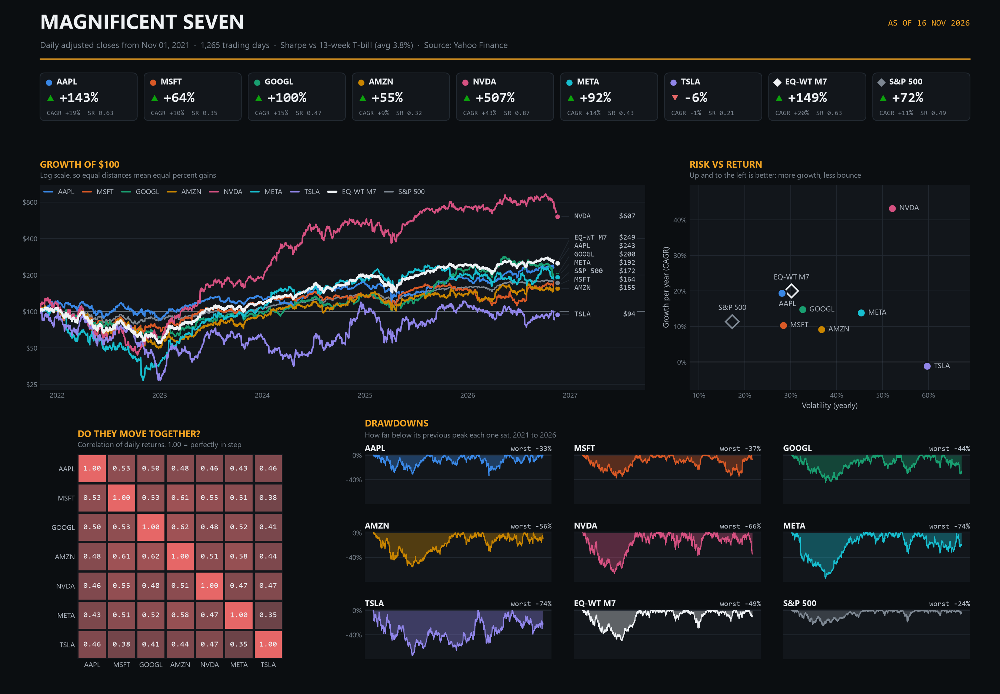

# Magnificent Seven Dashboard

**Live dashboard: https://zakjrademacher.github.io/magnificent-seven-dashboard/**

A risk and return dashboard for the seven largest US tech stocks (Apple, Microsoft, Alphabet, Amazon, Nvidia, Meta, Tesla), compared with the S&P 500. The live page refreshes itself every trading day.



## What it answers

- How much did each stock grow, and how does an equal-weight portfolio of all seven compare with the S&P 500?
- How risky was the ride (volatility, Sharpe ratio, drawdowns)?
- Do the seven actually diversify each other, or do they move together?
- Does a simple "momentum" signal beat the dumb baseline of always guessing "up"?

## Two ways to use it

**Live dashboard (`site/`).** An interactive web page with a 1Y / 2Y / 3Y / max period filter, hover readouts on every chart, and a full metrics table. Every weekday after the US market closes, a GitHub Actions workflow downloads fresh prices and republishes the page to GitHub Pages.

**Analysis notebook (`magnificent_seven_dashboard.ipynb`).** The original step-by-step analysis: load prices, check the data, compute the metrics, draw the static dashboard image, and run the honesty check.

## How the live page updates

1. `.github/workflows/update-dashboard.yml` runs on a schedule (weekdays at 22:17 UTC), on every push to `main`, and on demand from the Actions tab.
2. It runs `update_data.py`, which downloads daily adjusted closes from Yahoo Finance and writes `site/data.json`.
3. It publishes the `site/` folder to GitHub Pages. The page computes every metric in the browser from that data.

If a download fails, the workflow stops and the previous version of the page stays live.

## Run it locally

```
pip install -r requirements.txt
python update_data.py            # or: python update_data.py --from-csv  (offline, uses m7_prices.csv)
python -m http.server --directory site
```

Then open http://localhost:8000.

## Files

| File | What it is |
|---|---|
| `site/index.html` | The live dashboard page |
| `update_data.py` | Downloads prices and writes `site/data.json` |
| `.github/workflows/update-dashboard.yml` | Daily refresh and deploy |
| `magnificent_seven_dashboard.ipynb` | The analysis notebook |
| `m7_prices.csv` | Cached prices the notebook uses (Nov 1, 2021 to Nov 16, 2026) |
| `magnificent_seven_dashboard.png` | The static dashboard image from the notebook |

## Method notes

- Prices are adjusted for splits and dividends.
- The equal-weight portfolio holds one-seventh in each stock and rebalances daily.
- Sharpe ratio uses a 4% yearly risk-free rate.
- Volatility is the standard deviation of daily returns, scaled to a year (252 trading days).

## Limits

- The seven were picked because they won, so looking back overstates what choosing in advance would have earned (survivorship bias).
- Results depend on the start date.
- This is analysis practice, not investment advice.

## Stack

Python, pandas, NumPy, Matplotlib, yfinance, JupyterLab, plain HTML/SVG/JavaScript, GitHub Actions, GitHub Pages
